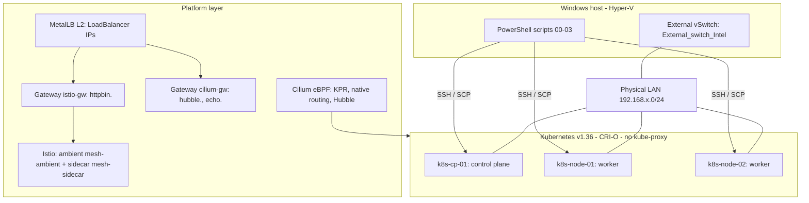
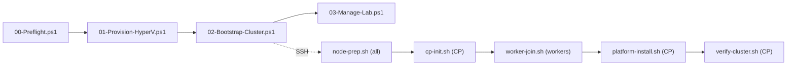

# Kubernetes Lab on Hyper-V — CRI-O · Cilium · Hubble · Gateway API · MetalLB · Istio


Four PowerShell scripts turn a Windows machine with Hyper-V into a **3-node kubeadm cluster** with a modern cloud-native networking stack. The build is fully automated, idempotent and self-verifying. It was built as a hands-on lab for the **Cilium Certified Associate (CCA)** and **Istio Certified Associate (ICA)** exams, and it is useful for anyone who wants a realistic eBPF and service-mesh playground on a single PC.

- **One command per stage:** host check, provision, bootstrap, manage. No WSL, Ansible or Vagrant needed; Windows' built-in OpenSSH does the remote work.
- **Idempotent:** every stage detects finished work and skips it, so after a failure you fix the cause and re-run the same command.
- **Self-verifying:** 48 automated checks prove the datapath, observability, mesh modes and north-south traffic, from inside the cluster and from Windows.
- **Secure by default:**
  - Every download is SHA-256 verified, and package repositories are signature-checked.
  - SSH is key-only.
  - The join token travels over SSH stdin with a 30-minute TTL and is revoked afterwards.
  - The kubeconfig file is ACL-restricted.

---

## Contents

- [Architecture](#architecture)
- [What you get](#what-you-get)
- [Requirements](#requirements)
- [Quick start](#quick-start)
- [How it works](#how-it-works)
- [Verification](#verification)
- [Using the lab](#using-the-lab)
- [Day-2 operations](#day-2-operations)
- [Configuration](#configuration)
- [Design decisions](#design-decisions)
- [Troubleshooting](#troubleshooting)
- [Repository layout](#repository-layout)
- [Roadmap](#roadmap)
- [Contributing](#contributing)
- [License](#license)

---

## Architecture



| Node | Role | vCPU | RAM | Disk | Default IP |
| --- | --- | --- | --- | --- | --- |
| `k8s-cp-01` | control plane | 2 | 4 GB | 30 GB dynamic VHDX | `.200` |
| `k8s-node-01` | worker | 2 | 4 GB | 30 GB dynamic VHDX | `.201` |
| `k8s-node-02` | worker | 2 | 4 GB | 30 GB dynamic VHDX | `.202` |

The VMs are Generation 2 with Secure Boot (`MicrosoftUEFICertificateAuthority`), static MACs and static IPs. They run from the official Ubuntu Server 26.04 cloud image, configured with cloud-init (NoCloud).

---

## What you get

| Layer | Component | Version | Notes |
| --- | --- | --- | --- |
| OS | Ubuntu Server | 26.04 LTS | Official cloud image, SHA-256 verified |
| Runtime | CRI-O | v1.36.x | systemd cgroups, pause image aligned with kubeadm |
| Kubernetes | kubeadm / kubelet / kubectl | latest v1.36.x | Version resolved once and held with `apt-mark hold` |
| CNI | Cilium | 1.20.2 | eBPF **kube-proxy replacement**, native routing, Gateway API |
| Observability | Hubble | relay + UI + metrics | UI published through Gateway API |
| Ingress | Gateway API | v1.6.1 (standard) | Two controllers side by side: `cilium` and `istio` |
| Load balancing | MetalLB | 0.16.1 | L2 mode, fixed IPs per Gateway |
| Service mesh | Istio | 1.31.1 | **Ambient** (ztunnel + waypoint) **and sidecar** mode side by side |
| CLIs on the control plane | helm, cilium, hubble, istioctl | v4.3.0, v0.20.1, v1.19.4, 1.31.1 | Checksum-verified; Istio samples in `/opt/istio/samples` |

Ready-made lab content:

| Namespace | Purpose |
| --- | --- |
| `mesh-ambient` | httpbin + curl in **ambient** mode, with a namespace **waypoint** for L7 |
| `mesh-sidecar` | httpbin + curl with classic **sidecar** injection (mTLS proven by XFCC header) |
| `demo-cilium` | httpbin outside the mesh, routed by the Cilium Gateway |
| `infra-gateways` | Gateway `cilium-gw` serving `hubble.lab.local` and `echo.lab.local` |
| `istio-ingress` | Gateway `istio-gw` serving `httpbin.lab.local` |

Kubernetes is pinned to the 1.36 line because Cilium 1.20 is e2e-tested on Kubernetes 1.33–1.36. The CRI-O minor version always matches the Kubernetes minor.

---

## Requirements

| Area | Requirement |
| --- | --- |
| Windows | 10/11 Pro or Enterprise, or Windows Server, with **Hyper-V** and its PowerShell module |
| Hardware | VT-x/AMD-V enabled; **12 GB free RAM** for the VMs plus ~2 GB for the host |
| Storage | NTFS or ReFS volume, ≥ 40 GB free (≥ 95 GB recommended); an external USB SSD works |
| Network | A **wired** adapter (default match: Intel); 3 free LAN IPs for nodes plus a small free range for MetalLB, all **outside DHCP** |
| Tools | Windows OpenSSH Client (`ssh`, `scp`, `ssh-keygen`), `curl.exe`, and QEMU's `qemu-img` (auto-installed via `winget` if missing) |
| Internet | HTTPS to Ubuntu, `dl.k8s.io`, `pkgs.k8s.io`, `download.opensuse.org`, GitHub, `registry.k8s.io`, `quay.io`, `ghcr.io`, Docker Hub, `get.helm.sh`, `helm.cilium.io`, `metallb.github.io` |
| Shell | Elevated PowerShell 5.1+ |

`00-Preflight.ps1` checks every item in this table for you.

---

## Quick start

```powershell
# 0. Clone and prepare (elevated PowerShell)
git clone https://github.com/<your-github-user>/<your-repo>.git
cd <your-repo>
Set-ExecutionPolicy -Scope Process Bypass
Get-ChildItem -Recurse | Unblock-File

# 1. Configure: node IPs, MetalLB pool, gateway IPs, storage path
notepad .\cluster.config.ps1

# 2. Check the host (read-only; -ApplyHostTuning helps USB-attached storage)
.\00-Preflight.ps1 -ApplyHostTuning

# 3. Build the switch, image and VMs             (~10-15 min)
.\01-Provision-HyperV.ps1

# 4. Build Kubernetes + platform, then verify    (~20-30 min)
.\02-Bootstrap-Cluster.ps1 -UpdateHostsFile

# 5. Reboot into the updated kernel and save a clean baseline
.\03-Manage-Lab.ps1 -Action Stop
.\03-Manage-Lab.ps1 -Action Start
.\03-Manage-Lab.ps1 -Action Checkpoint -Name baseline
```

Then open **http://hubble.lab.local**.

Run the commands on separate lines, or join them with `;`. Pasting two commands into one line is the most common first-run mistake.

---

## How it works



| Script | Runs on | What it does |
| --- | --- | --- |
| `00-Preflight.ps1` | Host | Read-only PASS/WARN/FAIL report of Hyper-V, tools, NIC and switch, addressing, free IPs, drive, RAM and 12 download sources. Optional host tuning (USB selective suspend, sleep off) and a Defender exclusion |
| `01-Provision-HyperV.ps1` | Host | Creates or reuses the external switch, downloads and verifies the Ubuntu image, converts qcow2 → VHDX, builds per-VM cloud-init seed ISOs (in-box IMAPI2) and Gen2 Secure Boot VMs, then waits for SSH and cloud-init |
| `02-Bootstrap-Cluster.ps1` | Host → VMs | Resolves one Kubernetes version, stages the bash scripts over SCP and runs them in order. It propagates the join token securely, exports the kubeconfig, verifies, tests the gateways from Windows and optionally updates the hosts file |
| `scripts/node-prep.sh` | All nodes | Turns swap off, loads `overlay`/`br_netfilter`, sets sysctls (including Cilium's `rp_filter` override), installs CRI-O + cri-tools + kubelet/kubeadm/kubectl (held) and applies hardening |
| `scripts/cp-init.sh` | Control plane | Runs `kubeadm init` (v1beta4 config) with the CRI-O socket and `skipPhases: [addon/kube-proxy]`, and sets up the kubeconfig for the admin user |
| `scripts/worker-join.sh` | Workers | Reads the join command from **stdin**, validates it against a strict allow-list (no `eval`) and runs `kubeadm join` |
| `scripts/platform-install.sh` | Control plane | Installs, in dependency order, the CLIs, Gateway API CRDs, Cilium, MetalLB, Istio (ambient profile) and the lab gateways and namespaces |
| `scripts/verify-cluster.sh` | Control plane | 48 end-to-end checks (see below) |
| `03-Manage-Lab.ps1` | Host | Status, ordered start/stop, and cluster-consistent checkpoints: restore and remove |

---

## Verification

`verify-cluster.sh` exits non-zero on any failure, and `02-Bootstrap-Cluster.ps1` then stops. A healthy build ends with `48 passed, 0 failed`.

| Area | What is proven |
| --- | --- |
| Nodes | 3 Ready, Ubuntu 26.04, runtime `cri-o://` |
| Cilium | Healthy; **no kube-proxy**; `KubeProxyReplacement: True`; `Routing: Native`; Istio-compatibility keys set |
| Hubble | Relay and UI rolled out; the `hubble` CLI reaches the relay; flows are recorded |
| Gateway API / MetalLB | GatewayClasses `cilium` and `istio` Accepted; MetalLB controller, speakers and pool present |
| Istio | istiod, istio-cni and ztunnel ready |
| Workload | NGINX spread across both workers; per-worker ClusterIP, CoreDNS and HTTPS egress |
| Sidecar mode | `istio-proxy` injected; HTTP 200; **mTLS proven** by the `X-Forwarded-Client-Cert` header |
| Ambient mode | No sidecar; ztunnel protocol **HBONE**; waypoint Programmed; HTTP 200 |
| North-south | Each Gateway holds its pinned MetalLB IP; `hubble.`, `echo.` and `httpbin.` return 200, also tested **from Windows** |

---

## Using the lab

| URL | Served by | Backend |
| --- | --- | --- |
| http://hubble.lab.local | Cilium Gateway `cilium-gw` | Hubble UI |
| http://echo.lab.local/get | Cilium Gateway `cilium-gw` | httpbin in `demo-cilium` |
| http://httpbin.lab.local/get | Istio Gateway `istio-gw` | httpbin in `mesh-ambient` (via waypoint) |

**SSH to the control plane.** All the CLIs are installed there:

```powershell
ssh -i "$env:USERPROFILE\.ssh\id_ed25519_k8s_hyperv" `
    -o UserKnownHostsFile="<VmRoot>\known_hosts" k8sadmin@<cp-ip>
```

**kubectl from Windows or WSL2.** The kubeconfig is exported to `<VmRoot>\kubeconfig`:

```bash
# WSL2
mkdir -p ~/.kube && cp /mnt/<drive>/<VmRoot-path>/kubeconfig ~/.kube/config && chmod 600 ~/.kube/config
kubectl get nodes -o wide
```

WSL copies the Windows hosts file at startup, so run `wsl --shutdown` once after `-UpdateHostsFile`.

<details>
<summary><b>Practice cheat-sheet: Cilium / Hubble (CCA)</b></summary>

```bash
cilium status
cilium config view | grep -E 'kube-proxy|routing|gateway|sock'
kubectl -n kube-system exec ds/cilium -c cilium-agent -- cilium-dbg status --verbose
kubectl -n kube-system exec ds/cilium -c cilium-agent -- cilium-dbg service list
kubectl -n kube-system exec ds/cilium -c cilium-agent -- cilium-dbg bpf lb list
cilium hubble port-forward &
hubble observe -n mesh-ambient --follow
hubble observe --verdict DROPPED
hubble observe --protocol http -n demo-cilium
```
</details>

<details>
<summary><b>Practice cheat-sheet: Istio (ICA)</b></summary>

```bash
istioctl proxy-status
istioctl analyze -A
istioctl ztunnel-config workload | grep -E 'NAMESPACE|mesh-ambient'   # pods: HBONE = in the ambient mesh
istioctl ztunnel-config service  | grep -E 'NAMESPACE|mesh-ambient'   # services: bound waypoint
kubectl -n mesh-ambient exec deploy/curl -- curl -s -o /dev/null -w '%{http_code}\n' http://httpbin:8000/get
kubectl -n mesh-ambient logs deploy/waypoint --tail=3                  # L7 access log proves the waypoint path
kubectl -n mesh-sidecar exec deploy/curl -c curl -- curl -s http://httpbin:8000/headers   # XFCC = mTLS
ls /opt/istio/samples                                                  # bookinfo, helloworld, ...
```

In ambient mode, the namespace label `istio.io/use-waypoint` binds the waypoint to **services**. Traffic sent to a service name gets L4 + L7 handling (ztunnel → waypoint → ztunnel). Traffic sent to a pod IP stays L4-only through ztunnel, so HTTP-level policies apply only to service-addressed traffic.
</details>

<details>
<summary><b>Practice cheat-sheet: Gateway API</b></summary>

```bash
kubectl get gatewayclass
kubectl get gateway,httproute -A
kubectl describe gateway cilium-gw -n infra-gateways
kubectl get svc -A --field-selector spec.type=LoadBalancer
kubectl -n metallb-system get ipaddresspool,l2advertisement
```
</details>

---

## Day-2 operations

| Task | Command |
| --- | --- |
| Status | `.\03-Manage-Lab.ps1 -Action Status` |
| Start (control plane first, waits for Ready) | `.\03-Manage-Lab.ps1 -Action Start` |
| Stop (workers first) | `.\03-Manage-Lab.ps1 -Action Stop` |
| Consistent checkpoint of all 3 VMs | `.\03-Manage-Lab.ps1 -Action Checkpoint -Name <name>` |
| Restore all 3 VMs | `.\03-Manage-Lab.ps1 -Action Restore -Name <name>` |
| List / remove checkpoints | `-Action List` / `-Action Remove -Name <name>` |
| Rebuild VMs from scratch | `.\01-Provision-HyperV.ps1 -Recreate` then `.\02-Bootstrap-Cluster.ps1 -UpdateHostsFile` |

Checkpoints stop the whole cluster first, so etcd and every node are captured at the same moment. Restoring one VM on its own would leave the cluster inconsistent.

With USB-attached storage, always run `-Action Stop` before unplugging the drive or sleeping the host. Keep the drive letter pinned in Disk Management.

---

## Configuration

Everything is set in **`cluster.config.ps1`**, which all four scripts read (they dot-source it). The settings you must review:

| Setting | Default | Notes |
| --- | --- | --- |
| `$VmRoot` | `F:\k8s-cluster-automation` | VM config, disks, **checkpoints**, image cache, kubeconfig. The drive must be NTFS or ReFS |
| `$Nodes[].IP` | `192.168.1.200-202` | Free LAN IPs outside DHCP |
| `$MetalLbPool` | `192.168.1.220-192.168.1.239` | Free LAN range outside DHCP |
| `$CiliumGatewayIP` / `$IstioGatewayIP` | `.220` / `.221` | Must be inside the pool |
| `$Gateway` / `$PrefixLength` | auto | **Pin them** if the host has more than one network |
| `$SwitchName` / `$NicMatch` | `External_switch_Intel` / `Intel` | Existing switches are reused |
| `$KubernetesMinor` / `$KubernetesVersion` | `v1.36` / latest patch | Set a version to pin it |

To move the examples to your subnet in one step:

```powershell
(Get-Content .\cluster.config.ps1) -replace '192\.168\.1\.', '192.168.8.' | Set-Content .\cluster.config.ps1
```

`Assert-Config` refuses to run on bad input: overlapping CIDRs, duplicate IPs or MACs, node IPs inside the MetalLB pool, or gateway IPs outside it.

---

## Design decisions

<details>
<summary><b>Cilium ↔ Istio coexistence settings</b></summary>

| Cilium value | Setting | Why |
| --- | --- | --- |
| `kubeProxyReplacement` | `true` | Required for Cilium's Gateway API controller; no kube-proxy is deployed (`skipPhases`) |
| `socketLB.hostNamespaceOnly` | `true` | Keeps socket-level LB out of pod namespaces, so sidecars and ztunnel see Service VIPs |
| `cni.exclusive` | `false` | Lets istio-cni chain onto `05-cilium.conflist` |
| `bpf.masquerade` | `false` | Istio ambient SNATs kubelet probes to `169.254.7.127`; BPF masquerade breaks them |
| `routingMode` | `native` + `autoDirectNodeRoutes` | Nodes share one L2 segment, so there's no VXLAN, and istiod webhooks work without `hostNetwork` |
| `l2announcements.enabled` | `false` | MetalLB owns ARP |

If you add a default-deny NetworkPolicy in an ambient namespace, also allow ingress from `169.254.7.127/32`.
</details>

<details>
<summary><b>Why a qcow2 image + qemu-img, not the Azure VHD?</b></summary>

Ubuntu's Azure VHD pins cloud-init to the Azure datasource and would ignore the NoCloud seed ISO. The generic cloud image is converted once with `qemu-img convert -O vhdx -o subformat=dynamic`. Its sparse flag is then cleared, because Hyper-V refuses sparse VHDX files, and the result is cached for rebuilds.
</details>

<details>
<summary><b>Security choices</b></summary>

- **Verified downloads:** the Ubuntu image, helm, cilium, hubble and istioctl are SHA-256 verified. The APT repositories (`pkgs.k8s.io`, `download.opensuse.org` for CRI-O) are signature-checked by `sqv`.
- **Access:** key-only SSH, no root login, and a locked password for the automation user.
- **Join token:** a dedicated 30-minute token, sent over SSH **stdin** and never on a command line, then revoked in a `finally` block.
- **kubeconfig:** exported with inheritance removed and access granted only to you and Administrators.
- **Packages:** held and blacklisted from unattended-upgrades.
- **Kernel hardening:** redirect and source-route sysctls, `dmesg_restrict` and `kptr_restrict`.
</details>

---

## Troubleshooting

| Symptom | Fix |
| --- | --- |
| `'...\lib\common.ps1' is not recognized` | The `lib` and `scripts` folders are missing. Clone the repo or extract the full archive |
| Preflight `FAIL Addressing` | Set the IPs to your LAN and pin `$Gateway` / `$PrefixLength` |
| `CRI-O CRI endpoint not responding` | Use the current `node-prep.sh`, which installs `cri-tools` explicitly |
| `istioctl: command not found` as a non-root user | `sudo chown -R root:root /opt/istio-* && sudo chmod -R a+rX /opt/istio-*` |
| `Could not resolve host: *.lab.local` | Complete `02 -UpdateHostsFile`; in WSL, also run `wsl --shutdown` |
| `bash: <word>: command not found` from `ssh '...'` | PowerShell 5.1 strips inner double quotes. Use `''` inside single quotes, or an interactive session |
| Nodes `NotReady` | Run `cilium status`; `/etc/cni/net.d` should contain only `05-cilium.conflist` |
| Gateway has no address | Run `kubectl -n metallb-system get ipaddresspool`; the pool IPs must be free |

Every script is safe to re-run after you fix the cause. See [CHANGELOG.md](CHANGELOG.md) for issues found on real hardware and how they were fixed.

---

## Repository layout

```
.
├── README.md
├── CHANGELOG.md
├── cluster.config.ps1           # all settings
├── 00-Preflight.ps1             # host checks (+ optional tuning)
├── 01-Provision-HyperV.ps1      # switch, image, VMs
├── 02-Bootstrap-Cluster.ps1     # Kubernetes + platform + verification
├── 03-Manage-Lab.ps1            # start / stop / checkpoints
├── lib/
│   └── common.ps1               # logging, IP math, SSH/SCP wrappers, config validation
└── scripts/                     # copied to and run on the VMs
    ├── node-prep.sh
    ├── cp-init.sh
    ├── worker-join.sh
    ├── platform-install.sh
    └── verify-cluster.sh
```

`.gitattributes` forces LF line endings for `*.sh`, so the bash scripts survive `core.autocrlf` on Windows. The bootstrap also strips CRs on the nodes as a fallback. `.gitignore` keeps kubeconfigs, SSH keys, known_hosts and disk images out of the repo.

---

## Roadmap

- [ ] Optional Prometheus, Grafana and Kiali add-on (`-WithObservability`)
- [ ] Cilium BGP control plane as an alternative to MetalLB L2
- [ ] HA control plane (3 × CP with kube-vip)
- [ ] Automated `kubeadm upgrade` path between minors
- [ ] Guided CCA/ICA exercise scenarios with checkpoints

---

## Contributing

Issues and pull requests are welcome. Before opening a PR:

1. **PowerShell:** run `Invoke-ScriptAnalyzer -Recurse -Severity Warning,Error .`
2. **Bash:** run `bash -n scripts/*.sh && shellcheck -S warning scripts/*.sh`.
3. **Behaviour:** keep the scripts **idempotent**, and keep every tunable in `cluster.config.ps1`.
4. **Verification:** run a full build and include the `verify-cluster.sh` summary.

---

## License

Add a `LICENSE` file before publishing. MIT or Apache-2.0 are common choices for infrastructure scripts.

---

<sub>Kubernetes, Cilium, Hubble, Istio, MetalLB, CRI-O and Ubuntu are trademarks of their respective owners. This project is not affiliated with or endorsed by them.</sub>
